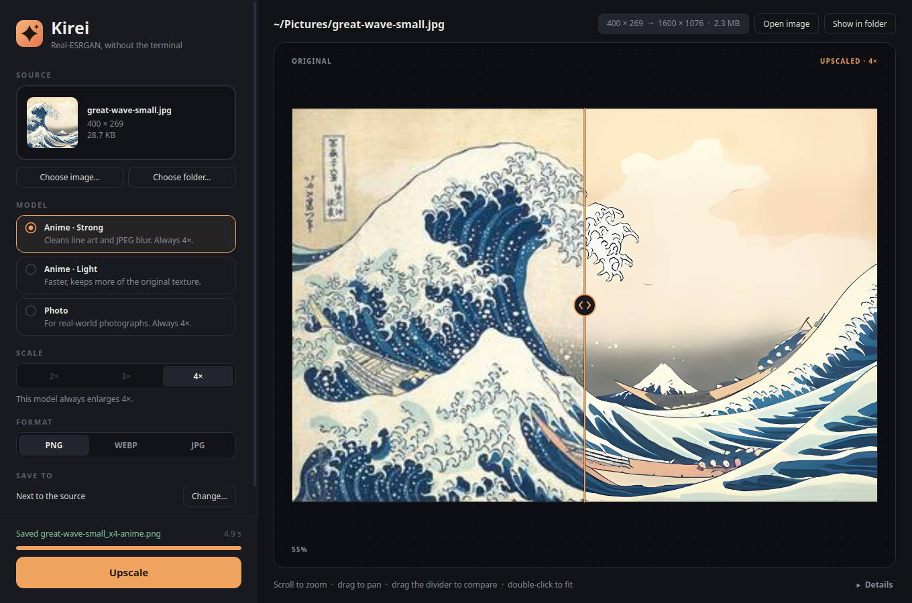
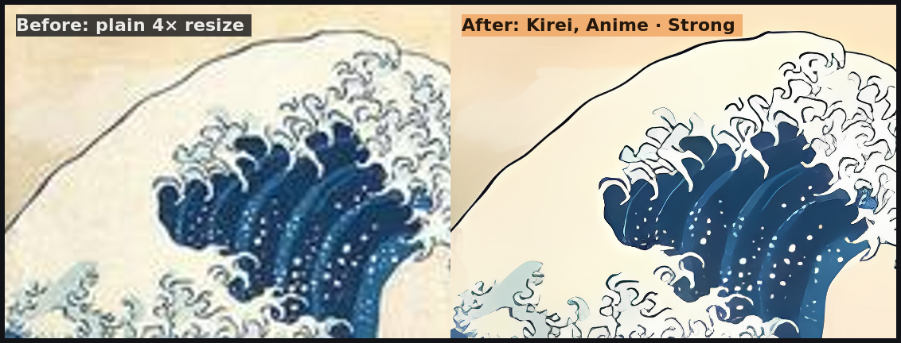
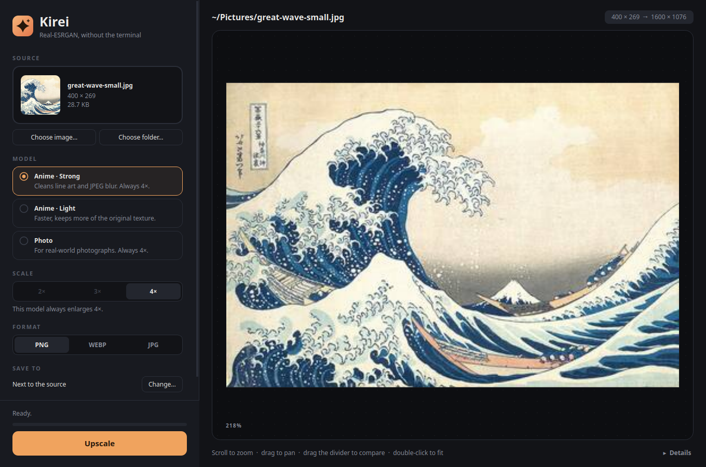
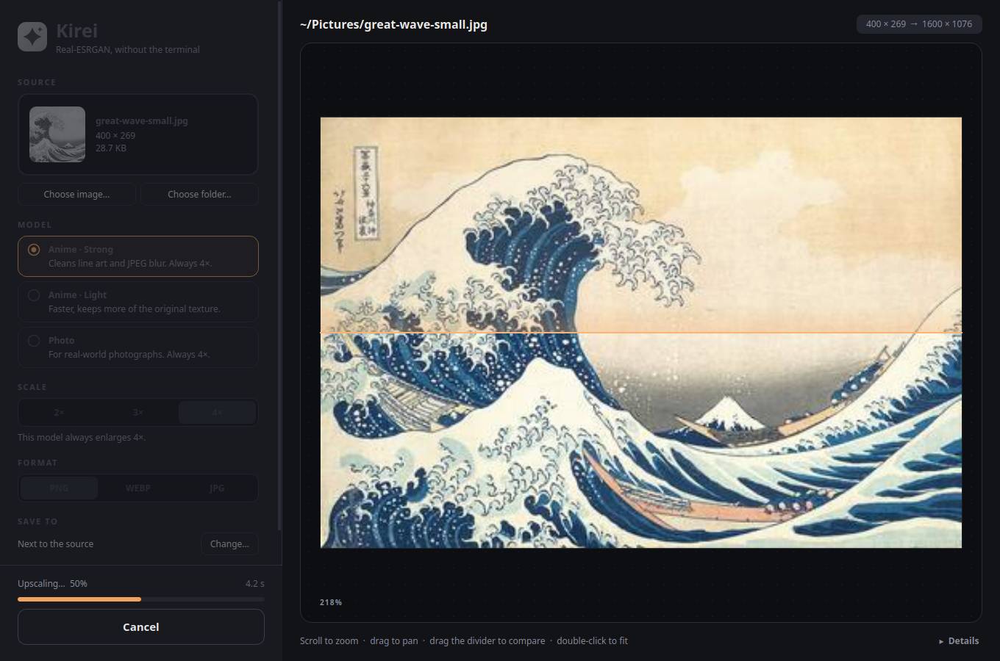

# Kirei

**Kirei** (綺麗, Japanese for *clean* / *pretty*) is a desktop app for
[Real-ESRGAN](https://github.com/xinntao/Real-ESRGAN). It gives the
`realesrgan-ncnn-vulkan` command-line tool a window: drop in an image, pick a
model, and compare the result with a draggable before/after slider.

Kirei doesn't upscale anything itself. Real-ESRGAN does the work on your GPU;
Kirei runs it for you, shows its progress, and shows you the result.




<sub>The same 400 × 269 JPEG enlarged 4×: a plain resize on the left, Kirei with
the *Anime · Strong* model on the right.</sub>

## Features

- Drag and drop an image, or a whole folder at once
- Three models: **Anime · Strong**, **Anime · Light** (2×/3×/4×) and **Photo**
- Before/after view with a draggable divider. Scroll to zoom, drag to pan.
- Live progress, cancel at any time, PNG / WEBP / JPG output
- Tile size and TTA options for GPUs with little memory, or for extra quality
- Remembers your settings, and adds **Open with Kirei** to your file manager

## Requirements

- Linux x86_64
- A GPU with Vulkan support. Intel, AMD and NVIDIA all work with up-to-date
  drivers, including integrated graphics.

## Install

### From a release

1. Download `kirei-<version>-linux-x86_64.tar.gz` from the
   [Releases](../../releases) page.
2. Extract it and run the installer:

   ```bash
   tar xzf kirei-*-linux-x86_64.tar.gz
   cd kirei-*-linux-x86_64
   ./install.sh
   ```

This installs Kirei to `~/.local/bin` and adds it to your app menu. It also
downloads Real-ESRGAN (44 MB) to `~/.local/opt/realesrgan-ncnn-vulkan` if you
don't have it yet. No root is needed.

Kirei needs Real-ESRGAN to work. If you skip the installer, for example by
running the binary directly, Kirei shows a **Download Real-ESRGAN** button the
first time you open it, and installs it to the same place. Either way, the
download is the official release from the Real-ESRGAN project, and Kirei checks
its SHA-256 checksum before installing it.

If you already have Real-ESRGAN somewhere else, run `./install.sh --no-realesrgan`
and set **Real-ESRGAN binary** under **Advanced** in the app.

### From source

```bash
git clone https://github.com/ayifa-hnk/kirei.git
cd kirei
./install.sh        # builds dist/kirei first, then installs it
```

To run it without installing:

```bash
python3 -m venv .venv
.venv/bin/pip install -r requirements.txt
.venv/bin/python main.py
```

## How to use it

### 1. Choose an image

Open Kirei from your app menu. Then do one of these:

- Drag an image onto the window.
- Click **Choose image…**.
- In your file manager, right-click an image and pick **Open with Kirei**.

**Choose folder…** upscales every PNG, JPG and WEBP in a folder, one after another.



The size it will come out at is shown at the top right, here
`400 × 269 → 1600 × 1076`.

### 2. Pick a model

| Model | Best for | Scale |
|---|---|---|
| **Anime · Strong** | Anime, manga, drawings, line art, and blurry or over-compressed JPEGs. Cleans up the most. | 4× |
| **Anime · Light** | The same kind of images, when you want to keep more of the original texture. Faster. | 2×, 3× or 4× |
| **Photo** | Real-world photographs | 4× |

Not sure? Start with **Anime · Strong** for drawings and **Photo** for pictures
taken with a camera.

Then choose the output **format**. PNG keeps every detail; WEBP and JPG are
smaller. Under **Save to**, choose where the result goes. By default it goes
next to the original, named like `picture_x4-anime.png`.

### 3. Upscale

Click **Upscale**, or press **Ctrl+Enter**. The progress bar fills as
Real-ESRGAN works, and **Cancel** (or **Esc**) stops it.



A small image takes a few seconds, even on integrated graphics. Large images
take longer, because the work grows with the number of pixels.

### 4. Compare

When it's done, the preview splits in two: the original on the left, the
upscaled image on the right.

- **Drag the divider** to compare the same spot.
- **Scroll** to zoom in on details, and **drag** to move around.
- **Double-click**, or press **Ctrl+0**, to fit the image again.
- **Open image** opens the result in your image viewer, and **Show in folder**
  opens its folder.

### If something goes wrong

Open **Advanced** at the bottom of the left panel:

- **Out of GPU memory, or a black or broken result:** lower the **Tile size**
  to 256 or 128. Big images get processed in smaller pieces.
- **"Real-ESRGAN isn't installed":** click **Download Real-ESRGAN** at the
  bottom left, or point **Real-ESRGAN binary** at a copy you already have.
- **TTA mode** makes results slightly better and runs about 8× slower.
- **Details**, at the bottom right of the preview, shows Real-ESRGAN's own
  output, which helps when reporting a problem.

## Shortcuts

| Key | Action |
|---|---|
| Ctrl+O | Choose an image |
| Ctrl+Enter | Upscale |
| Esc | Cancel |
| Ctrl+0 | Fit the preview |

## Uninstall

```bash
./uninstall.sh           # app, icon and menu entry
./uninstall.sh --purge   # also Real-ESRGAN and saved settings
```

## Building a release

```bash
./build.sh --package
```

This produces `dist/kirei` and `dist/kirei-<version>-linux-x86_64.tar.gz`. The
version comes from `__version__` in `main.py`.

## Credits

- [Real-ESRGAN](https://github.com/xinntao/Real-ESRGAN) by Xintao Wang et al.
  (BSD-3-Clause) does the actual upscaling. Kirei runs its ncnn/Vulkan build.
- [Qt for Python (PySide6)](https://doc.qt.io/qtforpython-6/) (LGPLv3) for the UI
- The demo image is *The Great Wave off Kanagawa* by Katsushika Hokusai
  (c. 1831), public domain, via
  [Wikimedia Commons](https://commons.wikimedia.org/wiki/File:Tsunami_by_hokusai_19th_century.jpg)
  and the Metropolitan Museum of Art.

## License

[MIT](LICENSE)
